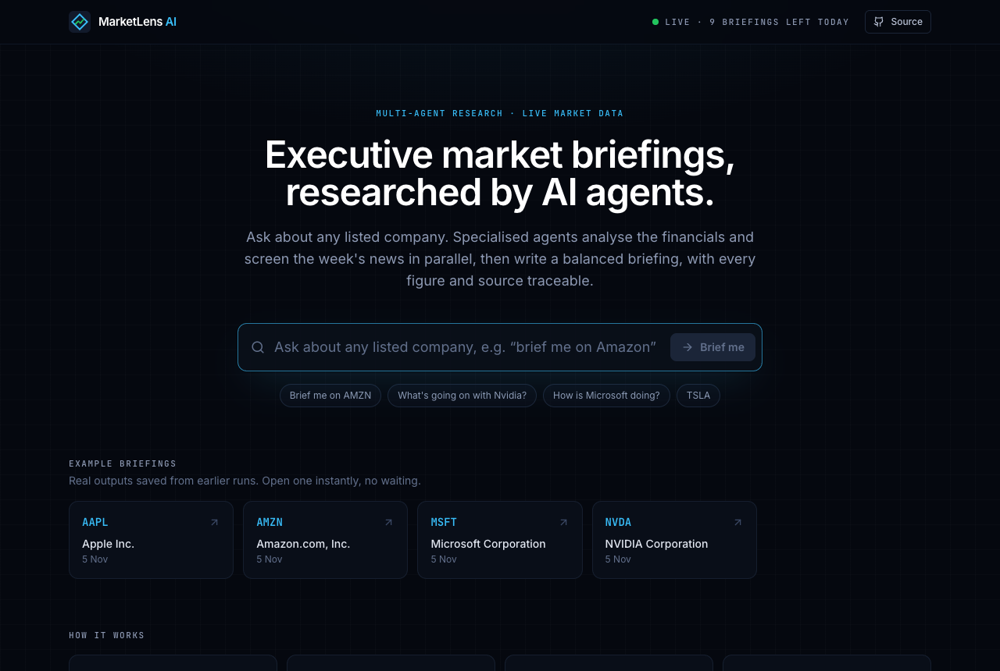
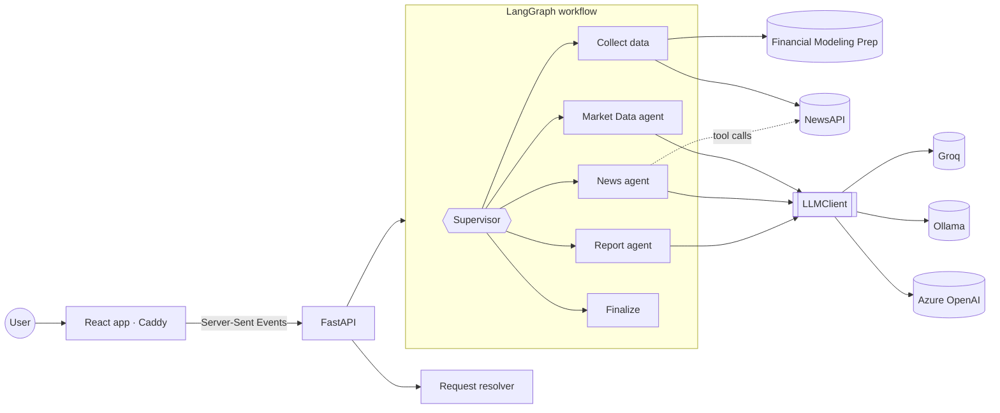

# MarketLens AI

MarketLens AI produces a short market briefing for a listed company. You ask for a
company in plain English ("brief me on Amazon"), it fetches market data and recent news,
runs a few LLM agents over them, and returns a Markdown report: company summary, recent
performance, key news, positives, risks and an overall assessment.

Backend: Python, FastAPI, LangGraph, Pydantic. Frontend: React, TypeScript, Tailwind.
Deployed with Docker Compose behind Caddy. The model provider is configurable
(Groq, Ollama or Azure OpenAI).

Not investment advice.



## Architecture



A request goes through these steps:

1. **Resolver** maps the user's message to a ticker (e.g. "Amazon" → `AMZN`), or asks a
   clarifying question if it's ambiguous.
2. **Supervisor** decides which node runs next based on the current state.
3. **Collect** fetches the quote, company profile, metrics and news. No LLM here.
4. **Market Data agent** and **News agent** run in parallel. The news agent can call a
   tool to read full articles or search again.
5. **Report agent** writes the narrative from both analyses.
6. **Finalize** renders the Markdown. Numbers and source links come from the data, not
   from the model.

If an agent or data source fails, the workflow still returns a briefing marked
`partial` with a warning. The React app streams each step's progress over SSE.

More detail in [docs/architecture.md](docs/architecture.md).

## Project structure

### Backend: `src/marketlens/`

| Path | Contents |
|---|---|
| `api/main.py` | FastAPI app factory |
| `api/routes/` | Endpoints: `analysis.py` (run a briefing), `briefings.py` (SSE stream, quota, examples), `companies.py` (snapshot, news), `health.py` |
| `api/schemas/` | Request/response models |
| `api/briefings_service.py` | Runs a briefing with caching and timeouts |
| `api/demo.py` | Limits for the public demo (cache, daily cap, per-visitor cap, queue) |
| `api/middleware.py` | Request IDs, access logs, fallback error handler |
| `api/errors.py` | Exceptions and the JSON error format |
| `api/dependencies.py` | FastAPI dependencies |
| `agents/graph.py` | The LangGraph workflow |
| `agents/state.py` | Shared state passed between nodes |
| `agents/nodes/` | One file per node: `supervisor`, `collect`, `market`, `news`, `report`, `finalize` |
| `agents/prompts.py` | Prompt templates |
| `agents/schemas.py` | Structured outputs the agents return |
| `agents/tool_loop.py` | Tool-calling loop used by the news agent |
| `agents/resolver.py` | Free text → ticker |
| `agents/signals.py` | Indicators computed from market data |
| `agents/rendering.py` | Markdown rendering of the final briefing |
| `agents/instrumentation.py` | Per-node error handling and tracing |
| `agents/dependencies.py` | Objects injected into the nodes (LLM, data clients, settings) |
| `llm/client.py` | `LLMClient` interface and the Groq / Ollama / Azure OpenAI implementations |
| `services/base.py` | Shared HTTP client (retries, backoff) |
| `services/fmp/` | Financial Modeling Prep client and response mapping |
| `services/newsapi/` | NewsAPI client and response mapping |
| `services/cache.py`, `rate_limit.py` | Response cache and rate limiter |
| `services/protocols.py` | Interfaces for market data and news providers |
| `services/registry.py` | Builds provider clients from settings |
| `services/errors.py` | Provider error types |
| `domain/` | Provider-independent models (ticker, quote, snapshot, news) |
| `core/config.py`, `logging.py` | Settings (from `.env`) and logging |
| `examples/` | Saved example briefings served by the API |
| `ui/` | Older Streamlit UI |

### Frontend: `frontend/src/`

| Path | Contents |
|---|---|
| `App.tsx`, `main.tsx` | App root and entry point |
| `api.ts` | API calls and SSE handling |
| `types.ts`, `format.ts` | Shared types and formatting helpers |
| `components/Composer.tsx` | Message input |
| `components/AgentPipeline.tsx` | Live progress of each agent |
| `components/BriefingView.tsx`, `Markdown.tsx` | Renders the briefing |
| `components/Examples.tsx` | Saved example briefings |
| `components/HowItWorks.tsx`, `Chrome.tsx` | Explainer section, header and footer |

### Other

| Path | Contents |
|---|---|
| `tests/` | Backend tests, split by `agents`, `api`, `services`, `llm`, `ui`, `unit`; recorded API responses in `fixtures/` |
| `scripts/fake_providers.py` | Fake FMP/NewsAPI server with injectable faults |
| `scripts/stress_test.py` | Load and bad-input tests against a running API |
| `scripts/probe_providers.py` | Checks data quality from the real providers |
| `scripts/generate_examples.py` | Generates the briefings in `docs/examples/` |
| `docker/` | Dockerfiles for the API, the web app (React + Caddy) and the Streamlit UI |
| `docker-compose.yml`, `docker-compose.prod.yml` | Local and production stacks |
| `deploy/` | Caddyfile and server setup script |
| `docs/` | Architecture notes, deployment guide, example briefings, screenshots |
| `.github/workflows/ci.yml` | CI: lint, type check, tests, image builds |
| `Makefile` | Common commands |

## Running locally

You need Python 3.11+, Node.js 22, and free API keys from
[Financial Modeling Prep](https://site.financialmodelingprep.com/developer/docs),
[NewsAPI](https://newsapi.org/register) and [Groq](https://console.groq.com/keys).

```bash
make install           # Python venv, dependencies, git hooks
make web-install       # frontend dependencies
cp .env.example .env   # add your API keys

make run-api           # API on http://localhost:8000 (docs at /docs)
make run-web           # app on http://localhost:5173
```

Or with Docker: `make docker-up`, then open http://localhost:8080.
Deployment to a server is described in [docs/deploy.md](docs/deploy.md).

To use a different model, set `LLM_PROVIDER` in `.env` to `groq` (default), `ollama` or
`azure_openai`.

## API

| Method | Path | Description |
|---|---|---|
| `POST` | `/api/v1/briefings/stream` | Free-text request, streams progress and the briefing over SSE |
| `POST` | `/api/v1/analysis` | `{"ticker": "MSFT"}` → full briefing as JSON |
| `POST` | `/api/v1/analysis/resolve` | Free text → ticker |
| `GET` | `/api/v1/companies/{ticker}/snapshot` | Market data |
| `GET` | `/api/v1/companies/{ticker}/news` | Recent news |
| `GET` | `/api/v1/examples` | Saved example briefings |
| `GET` | `/api/v1/briefings/quota` | Demo briefings left today |
| `GET` | `/health/live`, `/health/ready` | Health checks |

## Tests

```bash
make check       # ruff, mypy, pytest
make check-web   # frontend type check, tests, build
```

Tests don't hit the network: HTTP clients use recorded responses and agents use a fake LLM.

## Limitations

- On the free FMP plan, non-US companies only get profile data, so their briefings rely
  mostly on news.
- NewsAPI's free plan delays articles by about a day.
- Groq's free tier allows roughly a dozen new briefings per day.
