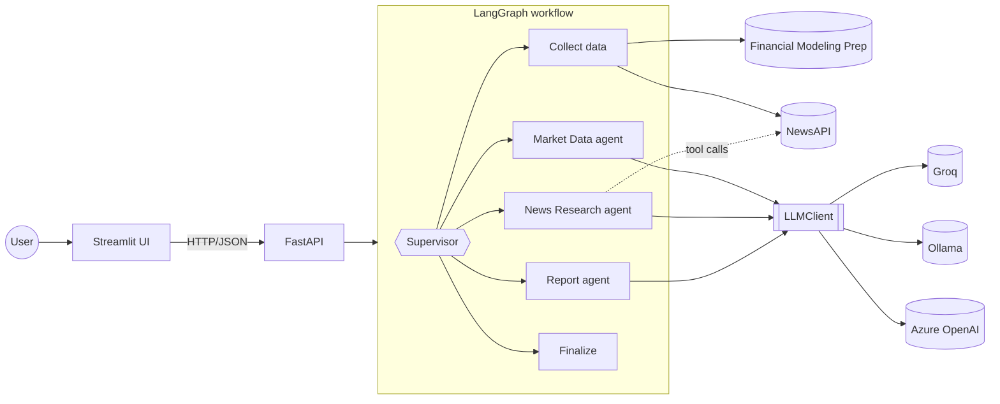

# MarketLens AI

**A multi-agent AI research analyst: enter a stock ticker, get an executive market briefing.**

MarketLens AI collects live market data and recent news for a company, has specialised
AI agents analyse the financials and the news in parallel, and writes a concise,
balanced briefing of the kind an analyst or consultant would read. It covers company
summary, recent performance, key developments, bullish signals, risks and an overall
assessment.

Built with **Python · FastAPI · LangGraph · Pydantic · Streamlit · Docker · GitHub Actions**.
It runs on free model providers (**Groq** or local **Ollama**) and on **Azure OpenAI**,
switched by configuration alone.

> MarketLens AI does not predict prices and is not investment advice.

---

## Example briefing

<!-- example-briefing:start -->
> Real output, generated by `scripts/generate_examples.py` with `groq:openai/gpt-oss-120b` on 25 October 2026. Other examples: [docs/examples](docs/examples).

<details open>
<summary><b>MSFT briefing</b></summary>

### Executive Market Briefing: Microsoft Corporation (MSFT)

*25 October 2026, 23:00 UTC · Status: complete · Confidence: high*

#### Company Summary

Microsoft Corp. operates across Productivity & Business Processes, Intelligent Cloud, and More Personal Computing, delivering software, cloud services and devices. FY2026 revenue rose 17.8% YoY and profitability remains high, with a market cap of $3.89 trillion. The stock trades near its 52‑week high at $524.51.

*Technology · Software - Infrastructure · US · 223,000 employees*

#### Recent Market Performance

The share rose 0.7% to $524.51, sitting at 86% of its 52‑week range and above both the 50‑day (+3.2%) and 200‑day (+20.2%) averages, indicating an uptrend. Beta of 1.099 suggests slightly higher volatility than the market. Free cash flow yield stands at 1.7%, modest but positive.

**Valuation.** Valuation is elevated relative to peers, with P/E near 30 and price‑to‑book above 8, suggesting the market has priced in strong growth and quality.

| Metric | Value |
|---|---|
| Share price | $524.51 (+0.7% on the day) |
| Market capitalisation | $3.89T |
| 52-week range | $349.20 to $553.72 (trading at 86% of range) |
| vs 50 / 200-day average | +3.2% / +20.2% (uptrend) |
| Revenue growth | +17.8% (FY2026) |
| P/E (TTM) | 29.1x |
| Gross margin (TTM) | 67.9% |
| Operating margin (TTM) | 46.8% |
| Net margin (TTM) | 40.3% |
| Return on equity (TTM) | 33.2% |
| Debt / equity | 0.29 |
| Free cash flow yield | 1.7% |
| Dividend yield | 0.7% |

#### Key News Developments

Investor focus this week centers on Microsoft’s AI‑driven earnings outlook and the hefty hardware spend needed to sustain it, with margin pressure and security concerns weighing on sentiment. At the same time, regulatory wins in Sweden and a breakthrough medical AI showcase growth opportunities, while an executive exit and a cloud‑security breach add modest heads‑up risks.

- **Microsoft AI earnings and cloud margin pressure**: Analysts note that Microsoft’s upcoming fiscal Q1 earnings will test cloud margins as AI spending surges. The stock is under pressure ahead of the report, reflecting investor concern over whether AI revenue can offset higher costs. *(negative, high importance)* Sources: [Biztoc.com](https://biztoc.com/x/d8ab0d8384d6c57f), [Biztoc.com](https://biztoc.com/x/03674d66ddddf17d)
- **Microsoft aims to retain more AI spend from Nvidia**: Two‑thirds of the $41 billion quarterly capex went to CPUs and GPUs, highlighting the costly hardware underpinning the AI push. Management is seeking to keep a larger share of AI profits by reducing reliance on Nvidia. *(negative, high importance)* Sources: [Biztoc.com](https://biztoc.com/x/aa89f516c3e00172)
- **Microsoft 365 accounts compromised at 79 organizations**: A threat actor replayed stolen sign‑in sessions to breach email accounts across 79 firms, using hidden inbox rules to evade detection. The incident underscores ongoing security challenges for Microsoft’s cloud services. *(negative, medium importance)* Sources: [Help Net Security](https://www.helpnetsecurity.com/2026/10/23/microsoft-365-accounts-stolen-sessions/)
- **Sweden blocks ChatGPT, approves Microsoft Copilot for government use**: Swedish central agencies barred public access to OpenAI’s ChatGPT and Anthropic’s Claude while green‑lighting Microsoft Copilot, illustrating divergent regulatory attitudes toward generative AI in the public sector. *(mixed, medium importance)* Sources: [Crypto Briefing](https://cryptobriefing.com/sweden-government-blocks-chatgpt-claude-copilot/), [Decrypt](https://decrypt.co/381763/sweden-government-offices-block-chatgpt-claude)
- **Xbox COO Helen Chiang departs after three months**: Helen Chiang, the first chief operating officer of Xbox, is leaving the role after a brief tenure, signaling possible organizational reshuffling within Microsoft’s gaming division. *(neutral, low importance)* Sources: [Eurogamer.net](https://www.eurogamer.net/xbox-coo-helen-chiang-leaves-microsoft), [Notebookcheck.net](https://www.notebookcheck.net/Xbox-COO-Helen-Chiang-leaves-Microsoft-three-months-after-taking-the-job.1432921.0.html)
- **Microsoft AI tool outperforms doctors in complex diagnoses**: Research from Microsoft shows its step‑by‑step diagnostic AI achieved more than double the accuracy of general physicians on challenging medical cases, highlighting a potential new revenue stream in health‑tech. *(positive, low importance)* Sources: [Biztoc.com](https://biztoc.com/x/28bb4ab605fa9040)

#### Bullish Signals

- ROE 33.2% and operating margin 46.8% signal high profitability
- Revenue grew 17.8% YoY for FY2026, showing strong top‑line momentum
- Debt‑to‑equity 0.29 and solid cash generation (FCF yield 1.7%) reflect a robust balance sheet
- Microsoft AI diagnostic tool outperformed doctors, opening a new health‑tech revenue avenue
- Swedish government approved Microsoft Copilot, indicating regulatory acceptance of its AI suite

#### Risk Factors

- Premium valuation (P/E 29.1, P/B 8.8) limits downside cushion
- AI‑driven capex pressure: two‑thirds of $41 B quarterly spend on CPUs/GPUs
- Cloud security breach compromising accounts at 79 firms
- Margin compression risk from higher AI infrastructure costs
- Executive turnover in Xbox could signal broader organizational shifts

#### Overall Assessment

Microsoft blends strong earnings power with aggressive AI investment, positioning it for continued growth. However, premium valuation multiples (P/E ~29, P/B 8.8) and rising AI‑related capex pressure margins in the near term. Security incidents affecting 79 organizations and the recent Xbox COO departure add modest headwinds. Regulatory wins and health‑AI breakthroughs provide upside potential, balancing the risk profile.

#### Confidence & Data Notes

**Confidence: high.** Data gaps: trailing‑12‑month EPS, detailed historical revenue growth, and absolute free cash flow amount are not provided.

Data gaps: Trailing twelve months EPS; Historical revenue growth trends; Absolute free cash flow amount.

News coverage: Coverage includes recent news from Oct 23-24, 2026, focusing on earnings expectations, AI spending, security incidents, regulatory actions, and executive changes. Sources span tech, finance, and security outlets; depth is limited to headline‑level details.

Sources: market data from Financial Modeling Prep (quote as of 23 Oct 2026 20:00 UTC); news from NewsAPI (30 articles screened).

---

*Generated automatically from third-party data for research purposes. Not investment advice, and not a prediction of future prices. Verify material facts against primary sources.*

</details>
<!-- example-briefing:end -->

## What this project demonstrates

| Area | How it shows up |
|---|---|
| **Agentic AI** | A LangGraph **supervisor** plans the run and re-plans after each step; the Market Data and News agents run **in parallel**; the News agent uses **tool calling** to decide which articles to read and whether to widen its search |
| **Reliability** | Every agent failure is contained. A provider outage, a failed agent, or even every model call failing still produces a briefing, marked `partial` with structured warnings ([failure matrix](docs/architecture.md#12-failure-handling-strategy)) |
| **Trustworthy output** | Figures come from data, not the model; news links come only from **verified** article ids; the model gets prompt-injection guardrails and must state its confidence and data gaps |
| **Vendor independence** | One `LLMClient` interface behind `LLM_PROVIDER=groq \| ollama \| azure_openai`, with an automatic structured-output **fallback** (JSON schema ⇄ function calling) for models that struggle with one method |
| **API engineering** | FastAPI app factory, dependency injection, typed request/response contracts, one error envelope, request-id tracing, structured JSON logs |
| **External integrations** | Financial Modeling Prep and NewsAPI clients with rate limiting, retries with backoff, caching, request coalescing, and typed errors |
| **Quality** | 247 tests (97% coverage), strict mypy, ruff, pre-commit, CI; no network or model calls in tests; chaos and load testing against a fake provider |

## Architecture



**How a briefing is produced**

1. **Supervisor**: a deterministic routing policy over typed state. It decides what runs
   next from what data exists and which steps succeeded, failed or were skipped.
2. **Collect data** (no AI): quote, company profile, TTM metrics, revenue growth and
   recent news, with fallbacks (e.g. profile-only for companies outside the free data
   plan).
3. **Market Data agent** and **News Research agent**, **in parallel**:
   * Market Data turns the numbers into strengths and concerns, each citing the figures
     behind it.
   * News Research scans ~30 headlines, reads the promising ones through a tool, discards
     noise (same-name companies, product reviews), merges duplicate stories, and ranks the
     developments that matter to investors.
4. **Report agent** writes the executive narrative from both analyses and is told
   explicitly what's missing and why.
5. **Finalize** assembles the Markdown: figures table and source links come from data,
   and warnings are surfaced at the top.

Each response also includes an **execution trace**: per step, its status, duration, model
calls, tokens, tool calls and fallbacks.

Deeper design notes: [docs/architecture.md](docs/architecture.md) covers the state model,
failure handling, LLM integration, resilience policy, and the decisions behind them.

## Quick start

### 1. Get three free API keys (about 5 minutes, no credit card)

| Service | Used for | Sign up |
|---|---|---|
| Financial Modeling Prep | Prices, company profiles, financial metrics | [site.financialmodelingprep.com](https://site.financialmodelingprep.com/developer/docs) |
| NewsAPI | Recent news | [newsapi.org/register](https://newsapi.org/register) |
| Groq | The language model (fast, free tier) | [console.groq.com/keys](https://console.groq.com/keys) |

### 2. Install and configure

Requires Python 3.11+ and git.

```bash
git clone https://github.com/DiegFari/marketlens-ai.git && cd marketlens-ai
make install                  # virtualenv + dependencies + git hooks
cp .env.example .env          # then paste your three keys into .env
```

### 3. Run

```bash
make run-api                  # API on http://localhost:8000 (interactive docs at /docs)
make run-ui                   # in a second terminal: UI on http://localhost:8501
```

Open http://localhost:8501, enter `MSFT`, and generate a briefing. Or call the API:

```bash
curl -X POST localhost:8000/api/v1/analysis \
     -H 'content-type: application/json' -d '{"ticker": "MSFT"}'
```

With Docker instead: `make docker-up` (same `.env`).

### Choosing a language model

| `LLM_PROVIDER` | Cost | Best for | Notes |
|---|---|---|---|
| `groq` (default) | Free tier | Development and demos | Fast; daily request and token limits apply. Model via `GROQ_MODEL` |
| `ollama` | Free, runs locally | Offline and private use | Install [Ollama](https://ollama.com), then `ollama pull qwen2.5:3b`. Needs a recent machine; slow on older CPUs |
| `azure_openai` | Paid | Enterprise deployment | Set `AZURE_OPENAI_*`; uses strict JSON-schema structured outputs |

## API

| Method | Path | Description |
|---|---|---|
| `POST` | `/api/v1/analysis` | `{"ticker": "MSFT"}` → briefing: Markdown, status, warnings, structured agent outputs, trace |
| `GET` | `/api/v1/companies/{ticker}/snapshot` | Quote, profile, TTM metrics, revenue growth |
| `GET` | `/api/v1/companies/{ticker}/news` | Recent news, de-duplicated, newest first |
| `GET` | `/health/live`, `/health/ready` | Liveness; version, model provider, configured integrations |

A partial result (one source or agent failed) is still a **200**, with `status: "partial"`
and a warning explaining the gap. Errors share one envelope,
`{"error": {"code", "message", "request_id", "details"}}`:

| Status | `code` | When |
|---:|---|---|
| 404 | `ticker_not_found` | Unknown ticker |
| 422 | `validation_error` / `insufficient_data` | Invalid input / no data from any source |
| 502 | `upstream_error`, `upstream_plan_restricted` | Data provider error |
| 503 | `llm_not_configured`, `upstream_unavailable`, `upstream_rate_limited` | Missing model key / provider outage or quota |
| 504 | `analysis_timeout` | Briefing exceeded `AGENT_WORKFLOW_TIMEOUT_SECONDS` |

## Testing and quality

```bash
make check        # ruff + strict mypy + 247 tests (what CI runs)
```

* **No network in tests.** Provider clients replay recorded payloads through
  `httpx.MockTransport`; agents run against a scripted `FakeLLM` that can emit tool calls,
  malformed output and failures.
* **Every failure path is tested** end to end through the real LangGraph graph: news
  agent down, report agent down, all model calls failing, plan-restricted company,
  unknown ticker, timeout, routing loop.
* **Chaos and load testing.** `scripts/fake_providers.py` emulates FMP and NewsAPI with
  injected faults (slow, flaky, quota exhausted, malformed), and `scripts/stress_test.py`
  sends hostile input and concurrent load through the real stack. That work found and
  fixed a cache stampede (53 upstream calls → 1) and an unbounded queue.
* **Data-quality probing.** `scripts/probe_providers.py` measures real provider output;
  it drove the news-search tuning from 54% to ~99% relevant headlines.

### Generating examples

```bash
python scripts/generate_examples.py            # MSFT NVDA ASML SAP → docs/examples/
```

Runs real briefings with your `.env`, saves them, records timings, tokens and fallbacks in
`docs/examples/runs.json`, and refreshes the example at the top of this README.

## Project structure

```
src/marketlens/
  api/        FastAPI: routes, schemas, middleware, error mapping
  agents/     LangGraph: graph, typed state, nodes/, prompts, rendering
  llm/        LLMClient + provider factory (Groq, Ollama, Azure OpenAI)
  services/   data providers: resilient base client, fmp/, newsapi/
  domain/     provider-agnostic models (StockQuote, MarketSnapshot, NewsFeed, …)
  core/       settings and structured logging
  ui/         Streamlit app
tests/        unit · api · services · agents · llm · ui
scripts/      fake providers, stress test, data probe, example generator
docs/         architecture and examples
```

## Limitations

Deliberate trade-offs of running entirely on free plans:

* **Coverage:** US-listed companies are fully supported. For non-US companies (e.g. ASML,
  SAP) FMP's free plan returns only the company profile, so their briefings are based on
  profile and news, and say so.
* **News:** NewsAPI's free plan delays articles by about 24 hours and is licensed for
  development use.
* **Model limits:** Groq's free tier has daily request and token caps; a briefing uses
  4–6 model calls.

## Roadmap

| Phase | Scope | Status |
|---:|---|---|
| 1 | Repository, configuration, logging, FastAPI and Streamlit skeletons, Docker, CI | ✅ |
| 2 | Data integration: FMP and NewsAPI clients, rate limiting, retries, caching, stress tests | ✅ |
| 3 | LangGraph multi-agent workflow, structured outputs, tool calling, graceful degradation, provider-agnostic LLM layer | ✅ |
| 4 | Richer UI (status, warnings, trace), briefing persistence | ⏳ |
| 5 | Cloud deployment and monitoring | ⏳ |

---

*Not investment advice. Briefings are generated automatically from third-party data and
may contain errors; verify material facts against primary sources.*
