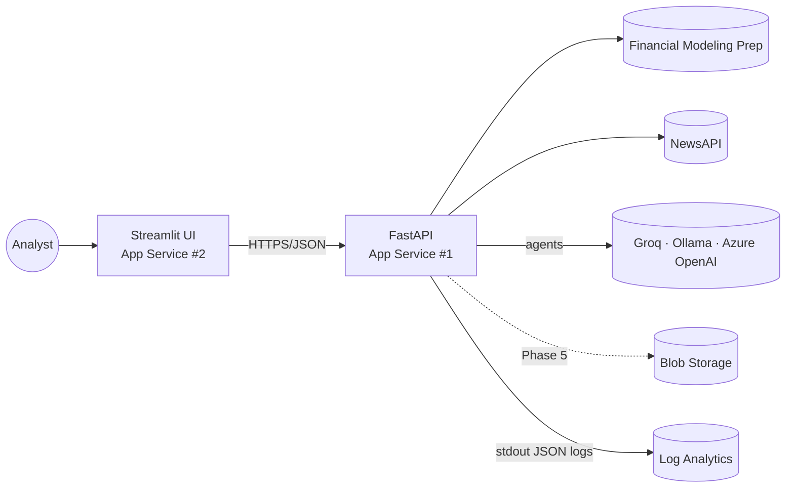
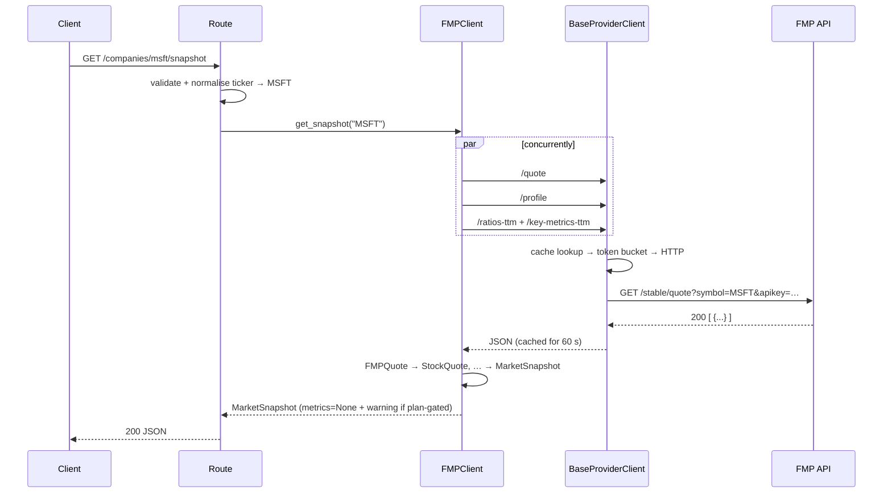
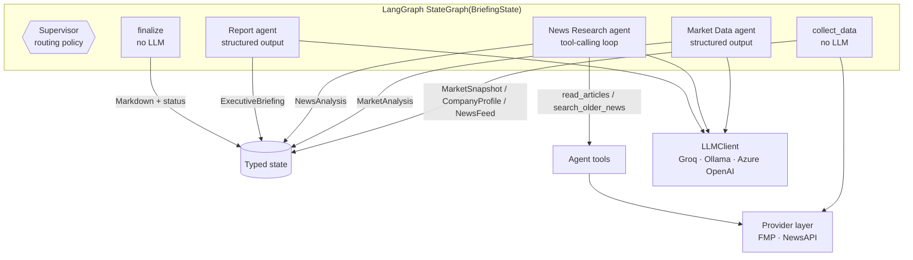
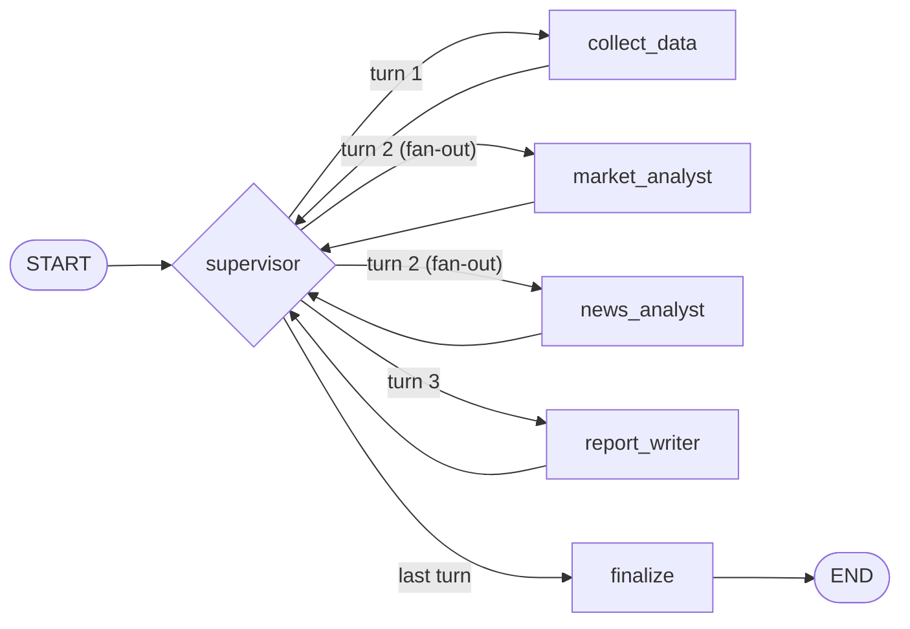

# MarketLens AI — Architecture

This document describes how the system is put together and why. It is updated at the
end of each phase. **Current state: Phase 3 (LangGraph multi-agent briefings).**

## 1. System context



| Deployable | Image | Holds secrets |
|------------|-------|---------------|
| API | `docker/api.Dockerfile` | Data provider keys, model provider key |
| UI | `docker/ui.Dockerfile` | None. It only knows `UI_API_BASE_URL` |

## 2. Layers inside the API

```
┌──────────────────────────────────────────────────────────────┐
│ api/routes/*            HTTP: validation, status codes       │
├──────────────────────────────────────────────────────────────┤
│ agents/                 LangGraph workflow (§9–§12)          │
│   graph.py · state.py · nodes/* · prompts.py · rendering.py  │
│ llm/client.py           LLMClient → Groq · Ollama · Azure    │
├──────────────────────────────────────────────────────────────┤
│ services/protocols.py   MarketDataProvider, NewsProvider     │  ← what callers depend on
├──────────────────────────────────────────────────────────────┤
│ services/fmp, services/newsapi                               │
│   client.py   endpoint methods, provider-specific errors     │
│   schemas.py  raw payload models → domain models             │
├──────────────────────────────────────────────────────────────┤
│ services/base.py        BaseProviderClient                   │
│   rate_limit.py · cache.py · errors.py                       │
├──────────────────────────────────────────────────────────────┤
│ httpx.AsyncClient       connection pooling, timeouts         │
└──────────────────────────────────────────────────────────────┘
domain/   StockQuote, CompanyProfile, FinancialMetrics, MarketSnapshot, NewsArticle, NewsFeed
```

Rules:

1. **Only `services/<provider>/schemas.py` knows provider field names.** Everything
   above works with `domain/` models, which are immutable (frozen Pydantic models), so
   they are safe to cache and to share between concurrent agents.
2. **Callers depend on protocols, not clients.** Routes receive a `MarketDataProvider`
   via FastAPI dependency injection, and the agent workflow receives the same objects
   through `AgentDependencies`. Tests pass plain fakes.
3. **Clients are long-lived.** `DataProviders` (in `services/registry.py`) is built once
   in the FastAPI lifespan and closed at shutdown, so connection pools, rate limiters and
   caches are shared across requests.

## 3. Request flow: `GET /api/v1/companies/MSFT/snapshot`



## 4. Resilience policy

All providers inherit the same behaviour from `BaseProviderClient`.

| Concern | Mechanism | Default |
|---------|-----------|---------|
| Bursts | Async token bucket per provider, checked before **every** attempt (retries included) | FMP 300/min, NewsAPI 30/min, burst 5 |
| Slow upstream | `httpx` timeout | 15 s |
| Transient failure (timeout, connection error, 5xx) | Retry with exponential backoff and full jitter | 3 retries, 0.5 s base, 8 s cap |
| 429 with short `Retry-After` (≤ 30 s) | Wait exactly `Retry-After`, then retry | — |
| 429 without hint / long `Retry-After` | **Fail fast** with `ProviderRateLimitError` | — |
| Quota preservation | TTL + LRU response cache keyed by path + params | quote 60 s, profile 24 h, metrics 6 h, news 15 min |
| Cache stampede | Identical concurrent requests are coalesced into one upstream call (single-flight) | always on |
| Overload | Waiting for rate-limiter capacity is bounded; beyond it the request fails fast with `upstream_rate_limited` | 10 s |
| Partial outage | Snapshot returns without metrics plus a `warnings` entry; news falls back to ticker-only search if the profile lookup fails | — |

**Why fail fast on 429s without a hint?** The token bucket already keeps us under
per-minute limits, so an unexplained 429 almost always means the *daily* quota is gone.
Retrying would only add latency before the same failure.

**Found by stress testing.** Coalescing and the bounded queue were added after
`scripts/stress_test.py` showed that 50 concurrent requests on a cold news key made 53
NewsAPI calls instead of 1. Those calls then queued behind the 30/min limiter for up
to 100 s. With both fixes, 1,000 requests make 4 upstream calls, and overload sheds
excess requests in about 10 s with a clean 503.

**Known limits (deliberate for this phase).** The limiter and cache are per process.
With several uvicorn workers or App Service instances, the effective rate is multiplied
and caches are not shared. The fix is Azure Cache for Redis behind the same interfaces;
it is not needed at portfolio scale.

## 5. Error model

Provider clients raise typed errors, and callers branch on the type, never on HTTP
codes or message text.

```
DataProviderError
├── ProviderNotConfiguredError   no API key
├── ProviderAuthError            401/403, invalid/disabled key
├── ProviderPermissionError      402, endpoint or symbol not in plan
├── ProviderRequestError         other 4xx: our request was wrong
├── TickerNotFoundError          empty result for a symbol
├── ProviderRateLimitError       429 / quota (carries retry_after)
├── ProviderUnavailableError     timeout, connection error, 5xx   ← retried
└── ProviderResponseError        non-JSON or unexpected shape
```

Provider quirks are normalised in each client:

* **FMP** has historically returned some errors as HTTP 200 with an `{"Error Message": …}`
  body, so these are classified by their text ("Limit Reach", "Invalid API KEY",
  "Premium"/"Restricted").
* **NewsAPI** returns `{"status": "error", "code": …}`. Codes map to error types
  (`rateLimited`/`apiKeyExhausted` → rate limit, `apiKeyInvalid` → auth, …).

`api/errors.py` maps each type to a status and a stable `code` (see the README table).
Provider wording is logged with the request id but **never returned to clients**.

## 6. Security

* Keys are `SecretStr` in settings and are unwrapped only in `registry.py` and the LLM
  client.
* **No key ever appears in a URL.** FMP uses an `apikey` header (verified against the
  live API) and NewsAPI uses `X-Api-Key`. An earlier version passed FMP's key as a query
  parameter, so it surfaced in `httpx`'s request logging whenever that was turned up; a
  test caught it in Phase 3, and a test now asserts the key is in neither the URL nor any
  log record.
* **Defence in depth:** a `RedactSecretsFilter` on the log handler masks
  `apikey=…`/`token=…`-style values from any logger, and `httpx` logging is pinned to
  WARNING.
* Tickers are validated against a strict pattern before reaching any provider or prompt.
* News text is treated as untrusted input to the model (prompt-injection guardrail in
  every agent prompt), and only verified article ids become links.

## 7. Data quality choices

* **News relevance (tuned on real data, 2026-10-25).** Queries combine the company name,
  stripped of legal suffixes ("ASML Holding N.V." → "ASML"), with the ticker. Tickers
  shorter than 3 characters are left out because they match unrelated words. The search
  covers **headlines first** and widens to descriptions only when there are fewer than
  10 headline matches. Package and download sites (`pypi.org`, `rlsbb.cc`) are
  excluded. Measured on MSFT, NVDA, ASML, AAPL, TSLA and SAP over 7 days:

  | Strategy | Named in headline | Junk articles |
  |---|---:|---:|
  | Titles + descriptions (original) | 54% | 48 / 249 |
  | + exclude junk domains | 64% | 0 |
  | + NewsAPI `sortBy=relevancy` | 75% | 0 |
  | **Headlines first, widen if thin (adopted)** | **~99%** | **0** |

  Still unsolved by keyword search, and handled by the News Research agent (LLM triage,
  §9): ambiguous names ("cane SAP" is a sugar price), consumer stories with no market
  relevance (Apple Watch reviews), and near-duplicates whose headlines differ by a word.
* **Market data coverage on FMP's free plan.** US listings (MSFT, NVDA, AAPL, TSLA)
  return all 14 TTM metrics and revenue growth. Non-US companies (ASML, SAP) return a
  profile only; quote and metrics fail with `402 Payment Required`.
* **News de-duplication.** If the same URL appears twice, the newest headline is kept
  (it is an edit). If the same headline appears under different URLs, the earliest copy
  is kept (it is syndication, and the earliest copy is usually the original publisher).
  Withdrawn `[Removed]` placeholders and entries without links are dropped.
* **Tolerant parsing.** Provider fields are optional, unknown fields are ignored, and
  `""` becomes `None`. A renamed ratio loses one number from a report instead of failing
  the whole request.

## 8. Adding a provider

1. Create `services/<name>/schemas.py` with raw payload models and `to_domain()` mappers.
2. Create `services/<name>/client.py` subclassing `BaseProviderClient`. Set `provider`,
   pass auth through `headers=` (never in URLs), and override `_error_for` only for
   quirks.
3. Make sure it satisfies the relevant protocol in `services/protocols.py`.
4. Add settings to `DataProviderSettings` and wire it in `DataProviders.from_settings`.
5. Add tests that replay recorded payloads through `tests/support.MockAPI`.

## 9. Agent architecture (Phase 3)

MarketLens turns a ticker into an executive briefing with a LangGraph workflow: a
**supervisor** that plans and re-plans, a deterministic **data collection** step, three
**LLM agents**, and a deterministic **finalize** step.



| Component | Input | Output | Uses the LLM | Tools |
|---|---|---|---|---|
| Supervisor | Whole state | `next_steps` | No (policy) | |
| `collect_data` | Ticker | `snapshot`, `profile`, `news`, warnings | No | |
| Market Data agent | `MarketSnapshot` + derived price signals | `MarketAnalysis`: strengths/concerns with cited figures, valuation view, data gaps | 1 structured call | None needed |
| News Research agent | `NewsFeed` headlines | `NewsAnalysis`: ranked developments citing article ids, sentiment, discarded ids | 1–3 tool turns + 1 structured call | `read_articles`, `search_older_news` |
| Report agent | Profile, key figures, both analyses, warnings | `ExecutiveBriefing` narrative | 1 structured call | |
| `finalize` | Whole state | `status`, `report_markdown` | No | |

A typical run makes **4–6 model calls**: the market and news analyses run in parallel,
then the report.

### Keeping the model honest

* **Numbers never come from the model.** The figures table is rendered from the snapshot,
  and price signals (52-week position, moving-average trend) are computed in
  `agents/signals.py` before the model sees them.
* **Sources are verified.** The News agent cites article ids. `verify_citations()` drops
  ids that don't exist, and developments left without a real source; links are built
  from the stored articles.
* **Gaps are explicit.** The Report agent is told which inputs are unavailable and why
  ("the agent failed", "no input data"), and is instructed to lower its confidence.
* **Shared guardrails** in every prompt: use only the supplied data, no price
  predictions or buy/sell advice, treat article text as untrusted (prompt injection).

## 10. LangGraph workflow



Every worker returns to the supervisor, which re-plans from the updated state. The
conditional edge returns a **list** of nodes, so when both analysts have input they run
in the same superstep (in parallel), and the supervisor resumes once both have finished.

Routing policy (`plan_next_steps`, a pure function tested rule by rule):

| Situation | Next |
|---|---|
| Data not yet collected | `collect_data` |
| Ticker unknown to FMP | `finalize` (insufficient data, **no model calls**) |
| Snapshot available / articles available | `market_analyst` / `news_analyst` (both: parallel) |
| No snapshot (e.g. ASML on the free plan) | market analyst **skipped**, no wasted call |
| Analysts done, failed or skipped, and any data exists | `report_writer` |
| Nothing at all to report on | `finalize` |
| Report attempted (success or failure) | `finalize` |
| `AGENT_MAX_SUPERVISOR_TURNS` reached | `finalize` + warning |

**Why the supervisor is not an LLM.** The workflow's shape is known in advance; what
varies is which inputs exist and which steps failed. That is policy, not language.
A deterministic supervisor is free, instant, reproducible and exhaustively testable,
and model calls are spent where judgment is actually needed: inside the agents.

## 11. State model

`BriefingState` (`agents/state.py`) is a Pydantic model and the graph's only
contract. Nodes never mutate it; they return partial updates that LangGraph merges.

| Group | Fields | Written by |
|---|---|---|
| Input | `ticker` | API |
| Collected data | `snapshot`, `profile`, `news`, `ticker_not_found` | `collect_data` (`news` re-written by the News agent so citation ids match) |
| Agent outputs | `market_analysis`, `news_analysis`, `briefing` | One agent each |
| Result | `status`, `report_markdown`, `generated_at` | `finalize` |
| Control | `next_steps`, `supervisor_turns` | Supervisor |
| Observability | `step_status` (merge reducer), `warnings` (append), `trace` (append) | Every node, via `instrument()` |

The reducers are what make parallel execution safe: both analysts append to
`warnings` and `trace` and merge into `step_status` in the same superstep without
overwriting each other. The agents' outputs are frozen Pydantic models and also serve
as the **strict JSON schemas** sent to Azure OpenAI (`agents/schemas.py`). Every field is
required and judgments are enums (`high`/`medium`/`low`), which a test enforces.

`WorkflowWarning` (`source`, `code`, `message`, `severity`) is the structured way
any part of the workflow reports degraded data. `severity="warning"` marks a material gap
(it makes the status `partial` and appears in the briefing's *Data notes* callout);
`"info"` is context shown in the confidence section.

## 12. Failure handling strategy

Every node runs inside `instrument()` (`agents/instrumentation.py`), which:

1. times the node and records LLM calls, token usage and tool calls on a `StepContext`
2. **catches any exception** and converts it to `step_status = FAILED` plus a user-facing
   `WorkflowWarning`, instead of raising into the graph
3. appends a `TraceEvent` either way

The supervisor reads `step_status` and routes around failures.

| What fails | What happens | Outcome |
|---|---|---|
| FMP: ticker unknown | Flagged; no model calls; API returns `404 ticker_not_found` | — |
| FMP: plan-restricted (ASML, SAP) | Profile fetched instead; market agent skipped; news searched by company name | `partial` + `not_in_data_plan` |
| FMP: outage | Profile fallback; news searched by ticker | `partial` + `market_data_unavailable` |
| FMP: metrics or revenue growth gated | Snapshot still returned; gap noted | `info` warning |
| NewsAPI: outage, quota, or no articles | News agent skipped | `partial` + `news_unavailable` / `no_recent_news` |
| News agent tool fails | Error returned **to the model as the tool result**; it carries on | — |
| Market or News agent fails | Report written from what remains; told what's missing | `partial` + `*_failed` |
| Report agent fails | Deterministic fallback: analysts' strengths/concerns/developments, figures table | `partial` + `report_writer_failed` |
| Every LLM call fails | Still returns a document with real figures and warnings | `partial` |
| Model output unparseable or refused | `LLMOutputError`, then handled as an agent failure | `partial` |
| Model invents article ids | Citations removed, `info` warning | — |
| Supervisor fails | `on_failure` routes straight to `finalize` (no loop) | `partial` |
| `finalize` fails | Runner renders the document itself | `partial` + `finalize_failed` |
| Routing loop | `AGENT_MAX_SUPERVISOR_TURNS` + LangGraph recursion limit | `partial` + `turn_limit_reached` |
| Too slow | `AGENT_WORKFLOW_TIMEOUT_SECONDS`; API returns `504 analysis_timeout` | — |
| Model provider 429/5xx | SDK retries (`LLM_MAX_RETRIES`), then agent failure as above | `partial` |
| Model cannot produce the schema | Retried once with function calling; if still invalid, agent failure | — or `partial` |
| Language model not configured | API returns `503 llm_not_configured`; data endpoints still work | — |

Partial briefings are a **200** with `status="partial"` and structured `warnings`, so
clients can show the briefing and its caveats together.

## 13. LLM integration

* **One client, three providers.** `llm/client.py` defines the `LLMClient` protocol
  (`chat` with tools, `structured` with a Pydantic schema) and `ChatModelClient`, the only
  code that talks to a model. `build_llm_client()` selects the provider from
  `LLM_PROVIDER`:

  | Provider | Transport | Default structured-output method |
  |---|---|---|
  | `groq` (default; free tier) | OpenAI-compatible API (`ChatOpenAI` + `GROQ_BASE_URL`) | function calling |
  | `ollama` (free, local) | Ollama's OpenAI-compatible endpoint | function calling |
  | `azure_openai` | `AzureChatOpenAI` | JSON schema (strict) |

  Model, endpoint, timeout, retries and temperature all come from settings; nothing is
  hard-coded. Temperature is unset by default because reasoning models reject
  non-default values. Agents never know which provider they're using.
* **Structured outputs with a fallback.** The primary method is configurable
  (`LLM_STRUCTURED_OUTPUT`). If it fails with an *output* problem (schema not supported,
  JSON that fails validation such as Groq's `json_validate_failed`, a refusal, or no tool
  call), the call is retried once with the **other method** (JSON schema ⇄ function
  calling). Real Groq runs showed both directions matter: `gpt-oss-20b` sometimes
  answers without calling the function, which JSON-schema mode avoids. Transport errors
  (429, timeouts) are not retried this way, because the SDK has already retried them
  with backoff.
* **Lessons from the first real runs** (all four example tickers, Groq free tier):
  given the raw tool-call history or the research prompt during its final structured
  call, the News agent sometimes called `read_articles` again, which Groq rejects. The
  final step now gets a tool-free system prompt and the research as plain notes.
  Free-tier token caps (200k tokens/day on `gpt-oss-120b`) are about 10–12 briefings. Each fallback is counted in the trace
  (`structured_fallbacks`), which is a direct signal of how well a model fits the task.
  Results are always validated by Pydantic, and `include_raw=True` turns parsing failures
  into explicit `LLMOutputError`s and records token usage.
* **Prompts** live in `agents/prompts.py` as `ChatPromptTemplate`s. `PROMPT_VERSION` is
  returned with every briefing, so any output can be traced to the prompts that made it.
* **Tool calling** is a bounded loop (`agents/tool_loop.py`): tools run concurrently,
  unknown tools and tool exceptions become error results, and `AGENT_NEWS_MAX_TOOL_ROUNDS`
  caps the loop.
* **Observability.** Each response includes the execution trace (per step: status,
  duration, LLM calls, tokens, tool calls). `AGENT_DEBUG=true` additionally logs graph
  updates, prompts and model outputs at DEBUG; it is off by default and should never be
  on in production.
* **Testing without a model.** `tests/agent_fakes.FakeLLM` implements `LLMClient` with
  scripted replies (including tool calls and failures). The fallback logic is tested
  against a stub chat model. CI never calls a real model.

## 14. Design decisions and deviations from the Phase 2 plan

The Phase 2 plan was to expose the provider clients as tools for *both* data agents.
Building it showed a better split:

* **Data collection is a deterministic node, not tool calls.** Every briefing needs
  the same snapshot and feed. Letting a model decide whether to fetch them adds a model
  round-trip and a way to forget data, and gains nothing. Collection also handles
  provider degradation (profile fallback, news by ticker) in tested code.
* **Tool calling is used where a decision is genuinely open:** the News agent decides
  which of ~30 headlines deserve reading (keeping prompts small) and whether coverage
  is thin enough to widen the search. Typed provider errors reach it as tool results
  it can reason about, as planned.
* **The Market Data agent has no tools.** Its whole input fits in one prompt, and the
  arithmetic it would need a tool for is precomputed.
* **The supervisor is a policy, not a model** (see §10).

## 15. Next: Phase 4

Report presentation and persistence: render the structured briefing (status, warnings
and trace) in the Streamlit UI, and store briefings in Azure Blob Storage.
